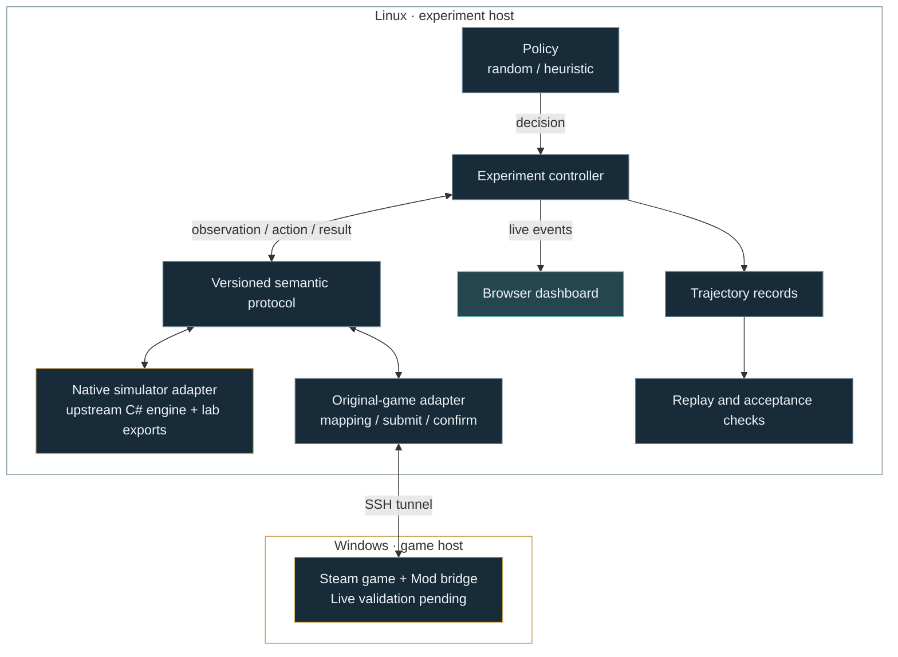

<div align="center">

<picture>
  <source media="(prefers-color-scheme: dark)" srcset="assets/logo-dark.svg">
  <source media="(prefers-color-scheme: light)" srcset="assets/logo.svg">
  
</picture>

<h1>Spire<sup>2</sup>Lab</h1>

**Inspectable decisions. Reproducible experiments.**

A research environment for autonomous agents in *Slay the Spire 2*.<br>
Semantic actions · Live decision inspection · Simulator-to-game validation

<p>
  <a href="#roadmap"></a>
  <a href="pyproject.toml"></a>
  <a href="sts2lab/contracts.py"></a>
  <a href="LICENSE"></a>
</p>

[Quick start](#quick-start) · [Python example](#python-example) · [Architecture](#architecture) · [Validation](#validation) · [Roadmap](#roadmap)

</div>

## Overview

Spire2Lab is an experimental foundation for researchers studying sequential decisions under partial observability. It provides a Linux combat simulator, random and heuristic policies, a browser dashboard, and a Windows game adapter behind a common semantic protocol. Each decision can be inspected through its observation, legal actions, candidate scores, selected action, and confirmed result.

The immediate goal is a trustworthy environment for later work on search, hierarchical decisions, and reinforcement learning. The platform separates player-visible information from hidden simulator state and keeps original-game evidence distinct from simulator tests. This makes it possible to investigate both **what an agent decided** and **whether the environment behaved as expected**.

> **Development status — phase 1.** The local simulator and dashboard are usable. The Windows adapter has synthetic transport tests; a compiled live Mod, repeatable original-game initialization, and real-game parity are still pending. Search algorithms, hierarchical policies, RL training, and original-game imagery are planned capabilities.

## Key features

| Capability | Implementation |
| --- | --- |
| **Semantic environment** | Typed observations, decision-scoped card/enemy references, legal actions, and versioned step results. Policies receive player-visible information. |
| **Live decision inspection** | Single-step and automatic execution, pause, manual overrides, candidate scores with their meaning, and recorded trajectory replay. The current dashboard is in Chinese. |
| **Simulator branching** | Exact snapshot/restore and independently sampled hidden worlds. Exact hidden-state snapshots are for debugging and regression; they must not become a policy oracle. |
| **Learning interface** | Gymnasium wrapper, entity encoding, action masks, termination/truncation handling, and process-isolated vector sampling tests. No training pipeline is included yet. |
| **Execution accounting** | Request IDs, stale-decision rejection, confirmation after uncertain responses, and explicit archival of unresolved original-game actions. |
| **Trace validation** | Hash-chain records, semantic re-execution, capture fingerprints, and a finite original-game acceptance matrix. Missing evidence keeps the gate incomplete. |

The platform code is developed here. The current mechanics engine, Python bindings, content tables, and Mod foundation have upstream dependencies. See [code provenance](CODE-PROVENANCE.md) for the exact boundary and the incremental replacement plan.

## Architecture



Linux runs simulation, policy execution, logs, and the dashboard. The separate Windows PC runs the game and bridge. Later search and training workloads belong on Linux; the Windows machine is reserved for real-game execution and capture.

One environment step is one player decision through settled execution. Animation waits and transport retries are not extra training steps. The dashboard renders observations and decisions; it does not implement game rules.

## Quick start

### Prerequisites

- **Linux x86_64**, Python **3.12+** with `venv` and `pip`, Git, `curl`, and `gcc`.
- System compiler/linker and development libraries for [.NET Native AOT](https://learn.microsoft.com/en-us/dotnet/core/deploying/native-aot/#prerequisites). This repository configures GCC for its native build.
- Network access for pinned Python packages, source archives, and the .NET SDK. The simulator example does not require a GPU or a running Windows game.

### Install and open the dashboard

```bash
git clone https://github.com/Lidz-abel/Spire2Lab.git
cd Spire2Lab
python3 scripts/bootstrap.py
bash scripts/start.sh
```

Bootstrap creates `.venv/`, downloads and verifies pinned upstream sources, installs a local .NET SDK when needed, builds the native library, and runs the project tests. A first build can take longer than five minutes; clean-machine installation has not yet been independently validated.

Open **http://127.0.0.1:8765** on the Linux host. For a remote server, forward port `8765` through SSH and open that address locally. API documentation is at `/docs`.

The dashboard starts with the native simulator. Use its single-step and automatic-run controls to execute decisions, then use replay to inspect the trajectory. Candidate scores are heuristic points or random priorities, not calibrated win probabilities.

### Python example

Run this from the repository root after bootstrap:

```bash
.venv/bin/python - <<'PY'
from sts2lab.simulator import Simulator
from sts2lab.policies import Policy

with Simulator("nibbits-weak", seed=1) as env:
    observation = env.observe()
    decision = Policy("heuristic", seed=773).decide(observation)
    result = env.step(decision.selected_action_id, observation.decision_id)
    print("policy:", decision.policy)
    print("score semantics:", decision.score_semantics)
    print("outcome after one action:", result.observation.outcome)
PY
```

With the current pinned build, this prints:

```text
policy: heuristic-v1
score semantics: heuristic_points
outcome after one action: ongoing
```

This executes one legal action through the same simulator adapter used by the dashboard. To build a Gymnasium experiment, start with [`CombatEnv`](sts2lab/gym_env.py) and its [usage tests](tests/test_environment.py); the tensor layout is documented in [ENCODING.json](ENCODING.json).

## Configuration and evaluation

The supported inventory is defined in [config/phase1.json](config/phase1.json):

| Setting | Phase-one scope |
| --- | --- |
| Character | Ironclad, Ascension 0 |
| Deck | `Strike ×5`, `Defend ×4`, `Bash ×1` |
| Starting state | Burning Blood, no potions, 80/80 HP, 99 gold, floor 2 |
| Encounters | `nibbits-weak`, `slimes-weak`, `sludge-spinner` |
| Seed split | Development: 1–10; held-out: 1001–1010 |
| Policies | `random-v1`, `heuristic-v1` |

The simulator target is `0.107.1`. This is not confirmation of the version installed on a user's Steam PC; that requires the actual build ID and DLL fingerprints.

Evaluate the fixed simulator inventory:

```bash
.venv/bin/python scripts/benchmark.py --split development
```

The script writes `artifacts/benchmark-development.json`, including per-episode outcomes, configuration, build fingerprints, and policy-plus-step timing without rendering. It also supports `--split heldout`; keep that split separate from tuning. The timing report does not record a full hardware inventory, so it is not a standardized cross-machine performance comparison.

Measure process scaling and verify that scheduling preserves seeded trajectories:

```bash
.venv/bin/python scripts/benchmark_sampling.py --workers 1 2 4 --repeats 3 --episodes-per-case 5
```

This writes `artifacts/sampling-development.json` with CPU/memory context, source fingerprints,
warm and end-to-end throughput, decision latency percentiles, and worker peak RSS. All layouts
execute the same cases; public trajectory hashes must match. Repetitions measure timing variation,
not additional independent evaluation seeds. The sum of worker RSS peaks is not simultaneous
physical memory usage. See the report's measurement definitions before comparing results.

### Original Windows game

The original-game workflow is separate from the simulator quick start:

1. Run [`Connect-Windows.ps1`](scripts/Connect-Windows.ps1) on the Steam PC with `-Server`, `-RemoteRoot` (the Linux checkout's absolute path), and `-SshPort` to collect version evidence, upload compile-time references, and open the SSH tunnels.
2. On Linux, run `.venv/bin/python scripts/build_bridge.py` against those references.
3. Close the game and run [`Install-Windows-Mod.ps1`](scripts/Install-Windows-Mod.ps1) with the same server, path and port, then launch through Steam and enable the Mod.
4. Start the Linux dashboard and verify one settled state/action/result before attempting a full reference battle.

The helpers require an absolute remote path using letters, digits, `_`, `.`, `/`, and `-`; spaces are currently unsupported. Connection setup checks the remote checkout before uploading. The installer verifies fingerprints, preserves license/build records, and backs up managed files for rollback. These behaviors have mocked PowerShell tests; the bridge has not yet been compiled or run against the local Windows game. Detailed operator steps are in [README.txt](README.txt).

## Validation

The current evidence is **engineering validation**, not a learned-agent performance result. [PHASE1-STATUS.json](PHASE1-STATUS.json) records local test results and evidence paths; generated reports are kept under ignored `artifacts/` and are not bundled with this repository.

| Check | What it establishes | Boundary |
| --- | --- | --- |
| [Environment tests](tests/test_environment.py) | Starter conditions, information boundaries, snapshot isolation, legal battles, Gym contract and vector sampling | Simulator scope |
| [Sampling tests](tests/test_sampling.py) | Trajectory consistency across worker layouts, failure handling and timeout cleanup | Simulator scope |
| [Windows helper tests](tests/test_windows_scripts.py) | Configurable paths, preflight refusal, fingerprint checks and install rollback | Mocked PowerShell; requires `pwsh` or `SPIRE2LAB_PWSH`, not a Steam installation |
| [Dashboard checks](scripts/check_dashboard.py) | Step, override, run/pause, replay and mobile layout | Native simulator UI |
| [Original adapter tests](tests/test_original.py) | Mapping and control contracts | Synthetic transport and upstream fixtures, not a local Steam capture |
| [Acceptance gate](config/acceptance.json) | 60 independent original reference battles plus required boundary coverage | **Incomplete: no local live-game cases** |

Run the project tests after installation:

```bash
.venv/bin/python -m pytest -q
```

With the dashboard running in another terminal, install the browser and check its interaction flow:

```bash
PLAYWRIGHT_BROWSERS_PATH="$PWD/.tools/browsers" .venv/bin/python -m playwright install chromium
PLAYWRIGHT_BROWSERS_PATH="$PWD/.tools/browsers" .venv/bin/python scripts/check_dashboard.py
```

Recompute the original-game gate with `.venv/bin/python scripts/audit_acceptance.py`. It is expected to exit with status `1` while Windows evidence or required captures are missing. Passing simulator tests does not satisfy this gate.

## Reproducibility and limits

- **Version the complete experiment.** Record the game build, simulator and Mod sources, native binary, protocol, encoding, configuration, policy, seeds, and reward rule. Relevant changes invalidate previous parity evidence.
- **Preserve the information boundary.** Policies receive observations, not internal RNG or hidden draw order. `sample_world` is a branching primitive; a full history-conditioned belief model is still future work.
- **Keep facts separate from rewards.** The current `terminal-win-v1` rule gives +1 for a win, −1 for a loss, and 0 otherwise. State changes remain available independently.
- **Handle unavailable and unresolved data explicitly.** Unknown action outcomes are not fabricated terminal transitions. Masked invalid Gym actions are marked `training_transition=False` and must be excluded from training data.
- **Report finite coverage.** The 60-case matrix covers three encounters, ten development seeds, and two baseline policies. It cannot establish correctness for every game mechanic. Controlled original-game initialization and RNG alignment remain unfinished.

## Project structure

```text
Spire2Lab/
├── assets/                 # original SVG identity, light and dark variants
├── sts2lab/                # contracts, adapters, control, Gym, traces, acceptance
├── native/                 # lab observation exports and upstream engine build
├── bridge/                 # extensions to the pinned Windows Mod
├── web/                    # browser dashboard; no frontend build required
├── scripts/                # bootstrap, builds, evaluation, checks, Windows setup
├── tests/                  # environment and execution contracts
├── config/                 # supported scope and acceptance matrix
├── CODE-PROVENANCE.md       # project code, dependencies, and source boundaries
├── ARCHITECTURE-PLAN.txt    # three-stage plan and phase-one milestones
└── PHASE1-STATUS.json       # machine-readable progress and evidence
```

## Roadmap

The current plan is **three-stage-v1**. Full tasks and exit criteria are in [ARCHITECTURE-PLAN.txt](ARCHITECTURE-PLAN.txt).

| Stage | Focus | Exit evidence |
| --- | --- | --- |
| **1 · Trusted experimental platform** | Semantic interfaces, observable decisions, replay, real-game control | Repeatable initialization, 60 independent real-game battles plus boundary coverage, UI and reproducibility checks |
| **2 · Search and hierarchical decisions** | Budgeted search, explicit goals and sub-decisions, incremental single-act support, original screenshots | Held-out baseline comparisons, fixed compute budgets, ablations and new mechanic reference cases |
| **3 · Efficient learning and original-game evaluation** | Policy/value learning, parallel sampling, batched inference, validated run-level support | Reproducible models, sample/time/compute measurements, generalization and simulator-to-game evaluation |

Original visuals begin with decision-boundary screenshots in stage 2, followed by synchronized presentation in stage 3. A vision-only policy is an optional separate research task. Independent bindings, a minimal Mod, and a finite combat engine will replace upstream components incrementally after their own validation.

## Development and provenance

For contributions, first read [AGENTS.md](AGENTS.md), the [project handoff](PROJECT-HANDOFF.md), and [code provenance](CODE-PROVENANCE.md). Keep changes scoped, run the relevant checks, and update evidence when behavior changes. Do not commit game DLLs, saves, raw private captures, or credentials.

Current upstream foundations are pinned and attributed:

- [evangambit/sts2](https://github.com/evangambit/sts2/tree/37e4264115546b6ac640d54aab3d7e2ac6983d2d): mechanics engine, bindings and content data.
- [evangambit/STS2MCP](https://github.com/evangambit/STS2MCP/tree/18bc23be210bbe804ae4471dfd2cb33bd481e247): Windows Mod foundation.
- [Gymnasium](https://gymnasium.farama.org/): environment conventions and vector interfaces.

## License and reference

The repository's [LICENSE](LICENSE) is MIT. Upstream components retain their own notices; game assets and proprietary assemblies are not covered by the project license. The SVG identity is drawn for Spire2Lab and contains no extracted game artwork or copied project logos.

To reference this work, cite the [Spire2Lab repository](https://github.com/Lidz-abel/Spire2Lab) with the commit used in your experiments. No research paper or trained checkpoint is currently provided.
