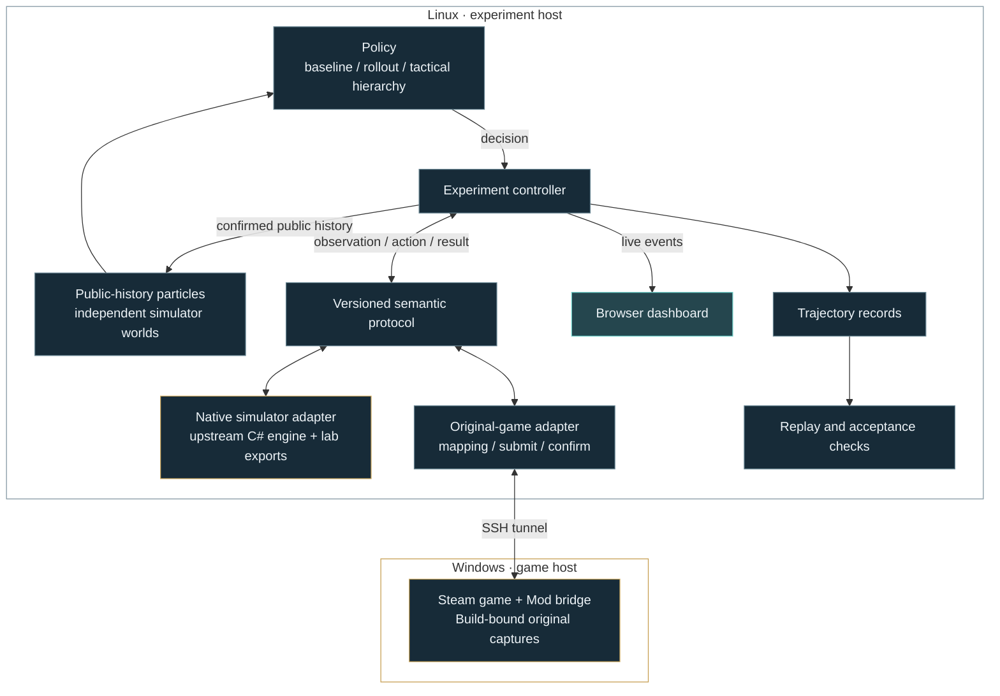

<div align="center">

<picture>
  <source media="(prefers-color-scheme: dark)" srcset="assets/logo-dark.svg">
  <source media="(prefers-color-scheme: light)" srcset="assets/logo.svg">
  
</picture>

<h1>Spire<sup>2</sup>Lab</h1>

**Inspectable decisions. Reproducible experiments.**

A research environment for autonomous agents in *Slay the Spire 2*.<br>
Semantic actions · Live decision inspection · Simulator-to-game validation

<p>
  <a href="#roadmap"></a>
  <a href="pyproject.toml"></a>
  <a href="sts2lab/contracts.py"></a>
  <a href="LICENSE"></a>
</p>

[Quick start](#quick-start) · [Python example](#python-example) · [Architecture](#architecture) · [Validation](#validation) · [Roadmap](#roadmap)

</div>

## Overview

Spire2Lab is an experimental foundation for researchers studying sequential decisions under partial observability. It provides a Linux combat simulator, baseline and rollout-search policies, a browser dashboard, and a Windows game adapter behind a common semantic protocol. Each decision can be inspected through its observation, legal actions, candidate scores, selected action, and confirmed result.

The current focus is observable-history search and persistent tactical goals on a trustworthy experimental environment. The platform separates player-visible information from hidden simulator state and keeps original-game evidence distinct from simulator tests. This makes it possible to investigate both **what an agent decided** and **whether the environment behaved as expected**.

> **Development status — three bounded PPO training runs are audited; phase 2 remains open.** E3 completed **98,304 simulator learning transitions** across three training seeds. One initial control hit an encoding-capacity limit, so the primary three-seed improvement comparison remains incomplete. Starter search and decision images have limited live evidence; normal first-act and learned-policy deployment acceptance remain outstanding. The phase-one checkpoint passed **60/60 original-game battles** and a separate probe across **9 boundary categories** ([scope](docs/LIVE-VALIDATION.md)). See [current evidence](PHASE2-STATUS.json) and [E3 results](docs/RL-E3-RESULTS.json).

## Key features

| Capability | Implementation |
| --- | --- |
| **Semantic environment** | Typed observations, decision-scoped card/enemy references, legal actions, and versioned step results. A shared [backend contract](docs/ENVIRONMENT-CONTRACT.md) defines supported operations and explicit refusals. |
| **Live decision inspection** | Single-step and automatic execution, pause, manual overrides, candidate scores with their meaning, and recorded trajectory replay. The current dashboard is in Chinese. |
| **Observable-history planning** | Independent sampled worlds constrained by confirmed public history, bounded root rollout search, explicit depletion/fallback, and candidate visits. No acting-environment snapshot or hidden RNG enters the planner. |
| **Tactical hierarchy** | Persistent survive/focus/progress goals with duration, termination and real reward accounting. Search shaping leaves the environment reward unchanged; goals are rule-based, not learned. |
| **Simulator branching** | Exact snapshot/restore and independently sampled hidden worlds, with branch IDs and parent-decision provenance. Exact hidden-state snapshots are for debugging and regression; they must not become a policy oracle. |
| **Bounded PPO training** | Public entity actor-critic, candidate masking, explicit-reset rollouts, GAE/PPO, persistent transition budget, checkpoint recovery and validation-only evaluation. [Contract](docs/RL-MVP.md), [run instructions](docs/RL-TRAINING.txt). |
| **Execution accounting** | Request IDs, stale-decision rejection, confirmation after uncertain responses, and explicit archival of unresolved original-game actions. |
| **Trace validation** | Hash-chain records, semantic re-execution, capture fingerprints, and a finite original-game acceptance matrix. Missing evidence keeps the gate incomplete. |

The platform code is developed here. The current mechanics engine, Python bindings, content tables, and Mod foundation have upstream dependencies. Explicit [native compatibility corrections](docs/NATIVE-COMPATIBILITY.md) address differences observed in the local game. See [code provenance](CODE-PROVENANCE.md) for the exact boundary and the incremental replacement plan.

## Architecture



Linux runs simulation, search, policy execution, PPO training, logs, and the dashboard. The separate Windows PC runs the game and bridge for real-game execution and capture.

One environment step is one player decision through settled execution. Animation waits and transport retries are not extra training steps. The dashboard renders observations and decisions; it does not implement game rules.

## Quick start

### Prerequisites

- **Linux x86_64**, Python **3.12+** with `venv` and `pip`, Git, `curl`, and `gcc`.
- System compiler/linker and development libraries for [.NET Native AOT](https://learn.microsoft.com/en-us/dotnet/core/deploying/native-aot/#prerequisites). This repository configures GCC for its native build.
- Network access for pinned Python packages, source archives, and the .NET SDK. The simulator example does not require a GPU or a running Windows game.

### Install and open the dashboard

```bash
git clone https://github.com/Lidz-abel/Spire2Lab.git
cd Spire2Lab
python3 scripts/bootstrap.py
bash scripts/start.sh
```

Bootstrap creates `.venv/`, downloads and verifies pinned upstream sources, installs a local .NET SDK when needed, builds the native library, and runs the project tests. A first build can take longer than five minutes. A fresh checkout at `2c25a99` passed installation on the same Linux host after transient download failures. That independent environment was later upgraded and rebuilt at `4f8447b`; its public trajectories matched on 60 fixed cases repeated five times. Binaries were not byte-identical, and installation on a second machine remains unverified. See the [versioned evidence](docs/LIVE-VALIDATION.md#reproduction-and-evidence-access).

Open **http://127.0.0.1:8765** on the Linux host. For a remote server, forward port `8765` through SSH and open that address locally. API documentation is at `/docs`.

The dashboard starts with the native simulator. Use its single-step and automatic-run controls to execute decisions, then use replay to inspect the trajectory. Candidate scores are heuristic points or random priorities, not calibrated win probabilities.

### Python example

Run this from the repository root after bootstrap:

```bash
.venv/bin/python - <<'PY'
from sts2lab.simulator import Simulator
from sts2lab.policies import Policy

with Simulator("nibbits-weak", seed=1) as env:
    observation = env.observe()
    decision = Policy("heuristic", seed=773).decide(observation)
    result = env.step(decision.selected_action_id, observation.decision_id)
    print("policy:", decision.policy)
    print("score semantics:", decision.score_semantics)
    print("outcome after one action:", result.observation.outcome)
PY
```

With the current pinned build, this prints:

```text
policy: heuristic-v1
score semantics: heuristic_points
outcome after one action: ongoing
```

This executes one legal action through the same simulator adapter used by the dashboard. To build a Gymnasium experiment, start with [`CombatEnv`](sts2lab/gym_env.py) and its [usage tests](tests/test_environment.py); the tensor layout is documented in [ENCODING.json](ENCODING.json).

## Configuration and evaluation

For search and tactical goals, see the [phase-two guide](docs/PLANNING.md). It includes dashboard/API usage, the information boundary, fixed-budget comparison commands and reproducibility limits. The [evaluation recipe](config/phase2-planning.json) keeps development and held-out seeds separate and compares both search policies against the existing baselines.

The supported inventory is defined in [config/phase1.json](config/phase1.json):

| Setting | Phase-one scope |
| --- | --- |
| Character | Ironclad, Ascension 0 |
| Deck | `Strike ×5`, `Defend ×4`, `Bash ×1` |
| Starting state | Burning Blood, no potions, 80/80 HP, 99 gold, floor 2 |
| Encounters | `nibbits-weak`, `slimes-weak`, `sludge-spinner` |
| Seed split | Development: 1–10; held-out: 1001–1010 |
| Policies | `random-v1`, `heuristic-v1` |

The simulator target is `0.107.1`. This is not confirmation of the version installed on a user's Steam PC; that requires the actual build ID and DLL fingerprints.

Evaluate the fixed simulator inventory:

```bash
.venv/bin/python scripts/benchmark.py --split development
```

The script writes `artifacts/benchmark-development.json`, including per-episode outcomes, configuration, build fingerprints, and policy-plus-step timing without rendering. It also supports `--split heldout`; keep that split separate from tuning. The timing report does not record a full hardware inventory, so it is not a standardized cross-machine performance comparison.

Measure process scaling and verify that scheduling preserves seeded trajectories:

```bash
.venv/bin/python scripts/benchmark_sampling.py --workers 1 2 4 --repeats 3 --episodes-per-case 5
```

This writes `artifacts/sampling-development.json` with CPU/memory context, source fingerprints,
warm and end-to-end throughput, decision latency percentiles, and worker peak RSS. All layouts
execute the same cases; public trajectory hashes must match. Repetitions measure timing variation,
not additional independent evaluation seeds. The sum of worker RSS peaks is not simultaneous
physical memory usage. See the report's measurement definitions before comparing results.

### Original Windows game

The original-game workflow is separate from the simulator quick start:

1. Run [`Connect-Windows.ps1`](scripts/Connect-Windows.ps1) on the Steam PC with `-Server`, `-RemoteRoot` (the Linux checkout's absolute path), and `-SshPort` to collect version evidence, upload compile-time references, and open the SSH tunnels.
2. On Linux, run `.venv/bin/python scripts/build_bridge.py` against those references.
3. Close the game and run [`Install-Windows-Mod.ps1`](scripts/Install-Windows-Mod.ps1) with the same server, path and port, then launch through Steam and enable the Mod.
4. Keep the game at its main menu and the tunnel open. On Linux, run `.venv/bin/python scripts/check_bridge.py`. It uses GET requests only and saves a separate report under `artifacts/windows/`.
5. Resolve the version gate, select the dedicated experiment profile, and use [controlled scenario preparation](docs/SCENARIO-STAGING.md) to establish an eligible opening. Select the original-game backend in the dashboard to attach to that battle. The dashboard connects to the current state; it does not reset the game. A passing main-menu check does not certify combat.

The helpers require an absolute remote path using letters, digits, `_`, `.`, `/`, and `-`; spaces are currently unsupported. Connection setup checks the remote checkout before uploading. The installer verifies fingerprints, preserves license/build records, and backs up managed files for rollback. These behaviors have mocked PowerShell tests. Steam public build `23811903` is verified as `v0.107.1`: its installation's `release_info.json` matches the received DLL's commit and assembly checksum, with full SHA-256 binding to the Windows report and runtime bridge. For DLLs exposing a generic version, copy that file separately into `artifacts/windows/`; the current connection helper does not upload it. Original reports remain unchanged. Detailed operator steps are in [README.txt](README.txt).

## Validation

Evidence separates original-game checks, simulator training and synthetic tests. [PHASE1-STATUS.json](PHASE1-STATUS.json) and [PHASE2-STATUS.json](PHASE2-STATUS.json) record scopes and evidence paths; generated traces and checkpoints remain under ignored `artifacts/`.

The [E2 CPU PPO smoke run](docs/RL-E2-RESULTS.json) used one training seed and 8,192 main-run transitions, plus 1,792 for recovery and worker checks. On the same **60 validation cases**, the selected learned policy won **60/60** with **69.47 mean final HP**; the heuristic won **60/60** with **76.55 HP**, and random won **52/60** with **31.27 HP**. Selection used these validation cases; the final test split remains untouched. This establishes a working learning loop, not superiority to the heuristic, held-out generalization or original-game performance. Recorded curve data, learner reload checks and exact first-update replay are indexed in the result summary.

The [E3 repeated runs](docs/RL-E3-RESULTS.json) trained three fresh models for **32,768 transitions each**. Each fixed-budget final model won all 60 validation cases, with **67.90 ± 0.30 HP** across training seeds (sample standard deviation), below the heuristic's **76.55**. Initial HP was 61.43, 0, and missing: seed 43 exceeded the fixed card encoding capacity in one initial-control case. An [explicit post-failure amendment](config/rl-e3-v1-amendment1.json) retained that error and allowed training within the original budget; no three-seed mean improvement is reported. All 98,304 transitions, 27 checkpoint reloads and each first-update replay passed their audits. [Execution instructions](docs/RL-E3-TRAINING.txt) and [case analysis](docs/RL-E3-ANALYSIS.txt) preserve this limitation. The final test split and original-game deployment remain pending.

The [E4 deployment adapter](docs/RL-DEPLOYMENT.txt) exposes the pinned PPO model through the combat API and dashboard. It accepts public starter observations, rejects unsupported inputs, and records model fingerprints, logits and confirmed actions without a rule fallback. **306 regression checks**, three simulator demonstrations (**30 actions**), compatibility with **48 historical original-game observations**, and desktop/mobile simulator replay checks passed. These are [offline and simulator results](docs/RL-E4-RESULTS.json); new original-game model battles and continuous first-act acceptance still require Windows connectivity and live evidence.

The first [planning evaluation](docs/PLANNING-RESULTS.md) covers **360 simulator battles**, **24 complete policy replays**, **152 tests** and one fresh original-game search battle. All benchmark configurations won their starter battles, but search finished with less HP than the heuristic baseline. This is a reproducible baseline with explicit limitations, not evidence of a performance gain. Full case counts, compute settings and build bindings are in the [phase-two summary](docs/PHASE2-VALIDATION.json).

| Check | What it establishes | Boundary |
| --- | --- | --- |
| [Environment tests](tests/test_environment.py) | Starter conditions, information boundaries, snapshot isolation, legal battles, Gym contract and vector sampling | Simulator scope |
| [Lifecycle contract tests](tests/test_environment_contract.py) | Reset, immutable branch ancestry, checkpoint restore and explicit original-game capability refusals | Native simulator and no-I/O refusal checks |
| [Training boundary tests](tests/test_training_boundary.py) | Invalid-action filtering, attempt-limit truncation and natural terminal precedence | Real simulator transitions; no RL training |
| [PPO implementation tests](tests/test_rl_training.py) and [saved-run audit](scripts/audit_rl_smoke.py) | Masked candidates, GAE boundaries, optimizer/RNG recovery, budget persistence, worker cleanup and recorded first-update reproduction | Synthetic tests and separate bounded simulator training; no original-game RL acceptance |
| [Sampling tests](tests/test_sampling.py) | Trajectory consistency across worker layouts, failure handling and timeout cleanup | Simulator scope |
| [Vocabulary tests](tests/test_vocabulary.py) | Public observations encode without backend ID tables; unknown content and incompatible traces are rejected | Protocol 0.3 / encoding v3; finite simulator regression |
| [Windows helper tests](tests/test_windows_scripts.py) | Configurable paths, preflight refusal, fingerprint checks and install rollback | Mocked PowerShell; requires `pwsh` or `SPIRE2LAB_PWSH`, not a Steam installation |
| [Dashboard checks](scripts/check_dashboard.py) | Step, override, run/pause, replay and mobile layout | Native simulator UI |
| [Original adapter tests](tests/test_original.py) | Mapping and control contracts | Synthetic transport and upstream fixtures, not a local Steam capture |
| [Main-menu bridge check](scripts/check_bridge.py) | HTTP access, protocol, reference fingerprint, process and state stability | Live read-only check passed; no semantic release or combat validation |
| [Release verification](sts2lab/release.py) | Release version, commit and assembly checksum bound to the received DLL | Local installation consistency, not a publisher signature |
| Live card-play probe | Request acknowledgment, energy, block and pile changes after one Defend | First-floor diagnostic only; no benchmark or dashboard validation |
| [Controlled openings](docs/SCENARIO-STAGING.md) | Independent initializations match public state, private draw order and repeatable RNG snapshots | Explicit repeated-opening check: Nibbit seed 1; each matrix case has a separate opening check |
| [Settlement gate tests](tests/test_settlement_gate.py) | Busy execution cannot become confirmed merely because public fields stop changing | Synthetic timelines; corrected bridge also exercised in the first complete live battle |
| [Live execution boundaries](docs/LIVE-VALIDATION.md#live-execution-and-browser-boundaries) | Real actions, GET-only response-loss recovery, duplicate/stale refusal, pause, manual override, loss and read-only browser replay | Controlled response loss; separately labeled probe, outside the 60-case count |
| [Acceptance gate](config/acceptance.json) | 60 independent original reference battles plus nine required boundary categories | **60/60 passed**, plus one boundary probe; **9/9 categories**. [Build-bound summary](docs/PHASE1-VALIDATION.json) |

Run the project tests after installation:

```bash
.venv/bin/python -m pytest -q
```

With the dashboard running in another terminal, install the browser and check its interaction flow:

```bash
PLAYWRIGHT_BROWSERS_PATH="$PWD/.tools/browsers" .venv/bin/python -m playwright install chromium
PLAYWRIGHT_BROWSERS_PATH="$PWD/.tools/browsers" .venv/bin/python scripts/check_dashboard.py
```

Recompute the original-game gate with `.venv/bin/python scripts/audit_acceptance.py`. It is expected to exit with status `1` while Windows evidence or required captures are missing. Passing simulator tests does not satisfy this gate.

## Reproducibility and limits

- **Version the complete experiment.** Record the game build, simulator and Mod sources, native binary, protocol, encoding, configuration, policy, seeds, and reward rule. Relevant changes invalidate previous parity evidence.
- **Keep encoding migrations explicit.** Protocol 0.3 removes backend numeric card IDs. Encoding v3 uses project-assigned tokens and records the vocabulary fingerprint; v2 tensors and protocol 0.2 traces require a declared migration, not relabeling.
- **Preserve the information boundary.** Policies receive observations, not internal RNG or hidden draw order. The planner uses `sample_world` only on independent particles, filters confirmed public history, and explicitly reports depletion. Its finite-particle belief is approximate, not an exact posterior.
- **Keep facts separate from rewards.** The current `terminal-win-v1` rule gives +1 for a win, −1 for a loss, and 0 otherwise. State changes remain available independently.
- **Handle unavailable and unresolved data explicitly.** Unknown action outcomes are not fabricated terminal transitions. Masked invalid Gym actions are marked `training_transition=False` and must be excluded from training data.
- **Report finite coverage.** The 60-case matrix covers three encounters, ten development seeds, and two baseline policies. It cannot establish correctness for every game mechanic. All 60 required references have matched the current simulator, with a separate loss/control probe. This conclusion applies to the recorded comparison fields and builds. Original captures are immutable, failed comparisons are retained, and catalog-derived card values are excluded from claims of independent live measurement.

## Project structure

```text
Spire2Lab/
├── assets/                 # original SVG identity, light and dark variants
├── sts2lab/                # adapters, belief/search/goals, control, Gym, traces
├── native/                 # lab observation exports and upstream engine build
├── bridge/                 # extensions to the pinned Windows Mod
├── web/                    # browser dashboard; no frontend build required
├── scripts/                # bootstrap, builds, evaluation, checks, Windows setup
├── tests/                  # environment and execution contracts
├── config/                 # supported scope and acceptance matrix
├── CODE-PROVENANCE.md       # project code, dependencies, and source boundaries
├── ARCHITECTURE-PLAN.txt    # three-stage plan and phase-one milestones
├── PHASE1-STATUS.json       # phase-one evidence and delivery status
└── PHASE2-STATUS.json       # search/hierarchy progress and remaining gates
```

## Roadmap

The current plan is **three-stage-v1**. Full tasks and exit criteria are in [ARCHITECTURE-PLAN.txt](ARCHITECTURE-PLAN.txt).

| Stage | Focus | Exit evidence |
| --- | --- | --- |
| **1 · Trusted experimental platform** | Semantic interfaces, observable decisions, replay, real-game control | Repeatable initialization, 60 independent real-game battles plus boundary coverage, UI and reproducibility checks |
| **2 · Search and hierarchical decisions** | Budgeted search, explicit goals and sub-decisions, incremental single-act support, original screenshots | Held-out baseline comparisons, fixed compute budgets, ablations and new mechanic reference cases |
| **3 · Efficient learning and original-game evaluation** | Policy/value learning, parallel sampling, batched inference, validated run-level support | Reproducible models, sample/time/compute measurements, generalization and simulator-to-game evaluation |

Original visuals begin with decision-boundary screenshots in stage 2, followed by synchronized presentation in stage 3. A vision-only policy is an optional separate research task. Independent bindings, a minimal Mod, and a finite combat engine will replace upstream components incrementally after their own validation.

The course E2/E3 training and E4 adapter work run alongside the remaining stage-two original-act gate. Their completion does not close that gate or the full-game objective. E3's registered budget is exhausted; further training requires a new experiment and resource registration. The next task is restoring Windows connectivity and validating the learned starter policy and the separate normal first-act controller in the original game.

## Development and provenance

For contributions, first read [AGENTS.md](AGENTS.md), the [project handoff](PROJECT-HANDOFF.md), and [code provenance](CODE-PROVENANCE.md). Keep changes scoped, run the relevant checks, and update evidence when behavior changes. Do not commit game DLLs, saves, raw private captures, or credentials.

Current upstream foundations are pinned and attributed:

- [evangambit/sts2](https://github.com/evangambit/sts2/tree/37e4264115546b6ac640d54aab3d7e2ac6983d2d): mechanics engine, bindings and content data.
- [evangambit/STS2MCP](https://github.com/evangambit/STS2MCP/tree/18bc23be210bbe804ae4471dfd2cb33bd481e247): Windows Mod foundation.
- [Gymnasium](https://gymnasium.farama.org/): environment conventions and vector interfaces.

## License and reference

The repository's [LICENSE](LICENSE) is MIT. Upstream components retain their own notices; game assets and proprietary assemblies are not covered by the project license. The SVG identity is drawn for Spire2Lab and contains no extracted game artwork or copied project logos.

To reference this work, cite the [Spire2Lab repository](https://github.com/Lidz-abel/Spire2Lab) with the commit used in your experiments. No research paper is published. Training produces local checkpoints; model weights and private game artifacts are not bundled in Git.
