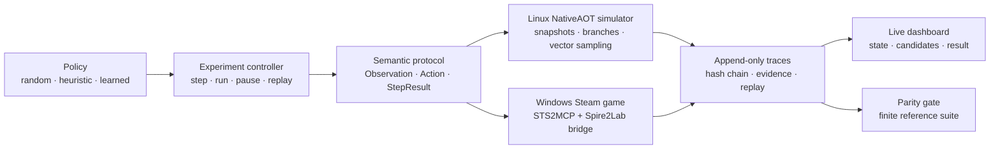

<div align="center">

# Spire<sup>2</sup>Lab

### A Reproducible Research Environment for Autonomous Play in *Slay the Spire 2*

<p>
  <a href="https://github.com/Lidz-abel/Spire2Lab">
    
  </a>
  
  
  
</p>

<p>
  <em>Observe. Search. Decide. Verify.</em>
</p>

</div>

Spire2Lab is a research codebase for building autonomous agents that can play *Slay the Spire 2* under a controlled information boundary. The project connects a fast Linux simulator with the original Steam game running on a separate Windows machine. Both backends expose the same versioned semantic protocol, so a decision made during simulation can be inspected, replayed, and eventually checked against the game itself.

The long term research direction is a single agent stack with:

- search over hidden-state-consistent simulator branches;
- hierarchical decisions that connect run-level goals to combat actions;
- efficient parallel sampling and learning;
- live decision inspection through a browser dashboard;
- finite, evidence-backed parity checks against the original game.

The repository currently focuses on the first requirement: a trustworthy, observable experimental environment. The original-game parity gate is intentionally visible in the status records and is not inferred from simulator-only tests.

## Research position

Spire2Lab treats an interactive card game as a partially observable decision process. The agent receives player-visible state and legal actions. Internal draw order, random streams, and other unavailable fields stay outside the policy observation. A trace records what the agent saw, what it proposed, what was executed, and what the environment confirmed.

This separation supports three kinds of experiments:

| Layer | Role | Current state |
| --- | --- | --- |
| **Environment** | Versioned observations, actions, rewards, snapshots, replay | Implemented for the phase-one combat scope |
| **Decision** | Random and interpretable heuristic policies | Implemented and logged |
| **Search** | Branching over consistent simulator worlds | Interface prepared; search algorithms are next |
| **Learning** | Gymnasium action masks and process-isolated sampling | Interface tested; training is a later phase |
| **Original game** | Windows Steam game, Mod bridge, raw captures | Adapter and control flow prepared; live validation pending |

## System overview



The Linux server is the compute side: it runs the simulator, search, policy inference, training jobs, traces, and dashboard. The lower-powered Windows PC runs Steam and the lightweight game bridge. This keeps high-throughput experimentation away from the game machine while preserving a path to real-game execution.

## What is already in the repository

- **Versioned semantic protocol** — typed observations, legal actions, terminal states, unavailable fields, and decision-scoped entity references.
- **Native simulator** — C# NativeAOT mechanics exposed to Python, with exact snapshots and independent sampled worlds.
- **Gymnasium environment** — `combat-entities-v2` encoding, action masks, explicit terminated/truncated handling, and invalid-sample filtering.
- **Observable policies** — random and explainable heuristic baselines that receive only `Observation`.
- **Experiment dashboard** — manual step, automatic execution, pause, candidate override, decision rationale, replay, and mobile layout.
- **Trace integrity** — append-only hash-chain records, semantic re-execution, stale-reference checks, and evidence fingerprints.
- **Original-game adapter** — asynchronous state reads, one-shot action submission, confirmation after uncertain responses, and safe archiving of unresolved runs.
- **Acceptance gate** — a fixed reference matrix and a report that remains incomplete until Windows evidence and real captures exist.

## Phase-one scope

The first milestone deliberately uses a small, reproducible benchmark:

- Ironclad, Ascension 0;
- five `Strike`, four `Defend`, and one `Bash`;
- `Burning Blood`, no potions;
- 80/80 HP, 99 gold, floor 2;
- `nibbits-weak`, `slimes-weak`, and `sludge-spinner`;
- ten development seeds and ten held-out seeds;
- random and interpretable heuristic policies;
- one decision per environment step, with animation waits excluded from the trajectory.

The planned live reference suite contains 3 encounters × 10 development seeds × 2 baseline policies = 60 independent original-game traces, plus boundary probes for outcomes such as loss. A matching finite trace supports only the declared scope and fields.

> **Current evidence boundary.** The Linux environment, dashboard, protocol, synthetic original transport, and local acceptance machinery are tested. Windows game DLL evidence, a compiled live Mod, initial-state/RNG alignment, and real-game parity traces are still required before phase one can be declared complete.

## Quick start on Linux

The bootstrap script keeps Python and .NET dependencies inside the project workspace.

```bash
git clone https://github.com/Lidz-abel/Spire2Lab.git
cd Spire2Lab

python3 scripts/bootstrap.py
.venv/bin/python -m pytest -q
.venv/bin/python scripts/build_bridge.py --prepare-only
```

Start the local dashboard:

```bash
bash scripts/start.sh
```

Open `http://127.0.0.1:8765`. The API documentation is available at `http://127.0.0.1:8765/docs`.

To run the browser smoke checks after installing the pinned Playwright browser:

```bash
PLAYWRIGHT_BROWSERS_PATH="$PWD/.tools/browsers" \
  .venv/bin/python scripts/check_dashboard.py

PLAYWRIGHT_BROWSERS_PATH="$PWD/.tools/browsers" \
  .venv/bin/python scripts/check_original_dashboard.py
```

The second command exercises the original-backend control contract with a synthetic transport. It does not count as evidence from the Steam game.

## Connecting the original Windows game

The repository does not contain the game, proprietary DLLs, saves, or a compiled Mod. On the Windows Steam PC:

1. Copy `scripts/Connect-Windows.ps1` to Windows and run it with the SSH destination used to reach the Linux server.
2. Let it collect the Steam build ID and reference DLL fingerprints, upload them to `artifacts/windows`, and keep the tunnel window open.
3. On Linux, compile the bridge against those exact references with `scripts/build_bridge.py`.
4. Run `scripts/Install-Windows-Mod.ps1` on Windows after closing the game.
5. Launch through Steam, enable the Mod if requested, and open the dashboard through the forwarded loopback port.

The complete operator procedure and failure handling are in [`README.txt`](README.txt). The current evidence and next handoff are in [`PROJECT-HANDOFF.md`](PROJECT-HANDOFF.md).

## Repository map

```text
Spire2Lab/
├── sts2lab/                 # semantic contracts, simulator, Gym, bridge, parity
├── native/                  # NativeAOT exports for the lab
├── bridge/                  # source hooks compiled into the Windows Mod
├── web/                     # no-build browser dashboard
├── scripts/                 # bootstrap, builds, benchmarks, audits, Windows onboarding
├── tests/                   # protocol, simulator, runtime, parity, and acceptance tests
├── config/                  # phase-one and live-reference suite definitions
├── ENCODING.json            # combat-entities-v2 training encoding
├── ARCHITECTURE-PLAN.txt    # full roadmap from environment to hierarchical RL
├── PHASE1-STATUS.json       # machine-readable status and evidence ledger
└── PROJECT-HANDOFF.md       # canonical context for a new session or collaborator
```

## Roadmap

**Phase 1 — Trusted environment.** Finish the Windows bridge, establish controlled original-game initialization, align the observable opening state, collect the finite reference suite, and verify every declared field with raw captures.

**Phase 2 — Combat search.** Add budgeted search over simulator branches while preserving the same observation boundary. Compare random, heuristic, and search policies under fixed wall-clock and node budgets.

**Phase 3 — Efficient learning.** Add a learned policy and value baseline, process-isolated rollout workers, batched inference, checkpointed datasets, and sample-efficiency measurements.

**Phase 4 — Hierarchical decisions.** Extend from combat actions to run goals, map choices, deck/resource objectives, and explicit parent-child decision records.

**Phase 5 — Original-game visualization.** Associate original screenshots or low-rate video frames with `run_id`, `decision_id`, and confirmed game state. A future vision-only agent will be evaluated as a separate observation pipeline.

## Reproducibility rules

Every claim should identify the game target, simulator commit, Mod build, protocol version, configuration, seed split, policy version, and evidence paths. Synthetic transport tests, simulator benchmarks, and live original-game traces are different evidence classes. A changed source fingerprint invalidates the relevant acceptance result.

The project pins the following upstream foundations:

- [evangambit/sts2](https://github.com/evangambit/sts2/tree/37e4264115546b6ac640d54aab3d7e2ac6983d2d) — NativeAOT simulator foundation, pinned at `37e4264`.
- [evangambit/STS2MCP](https://github.com/evangambit/STS2MCP/tree/18bc23be210bbe804ae4471dfd2cb33bd481e247) — original-game state and action bridge foundation, pinned at `18bc23b`.
- [Gymnasium](https://gymnasium.farama.org/api/env/) — reset/step semantics and training environment conventions.

## Project status and handoff

The canonical progress record is [`PROJECT-HANDOFF.md`](PROJECT-HANDOFF.md). It is written for a new conversation: read it first, then inspect the current worktree and evidence files before changing code.

The project is currently in **Phase 1, awaiting Windows live-game inputs**. Local simulator and UI evidence must not be reported as full original-game parity.

Code ownership and upstream boundaries are documented in [`CODE-PROVENANCE.md`](CODE-PROVENANCE.md).

## Citation

If Spire2Lab becomes useful in research, please cite the repository:

```bibtex
@software{spire2lab2026,
  title  = {Spire2Lab: A Reproducible Research Environment for Autonomous Play in Slay the Spire 2},
  author = {Lidz-abel},
  year   = {2026},
  url    = {https://github.com/Lidz-abel/Spire2Lab}
}
```

<div align="center">
  <sub>Built for careful experiments where every decision can be inspected.</sub>
</div>
