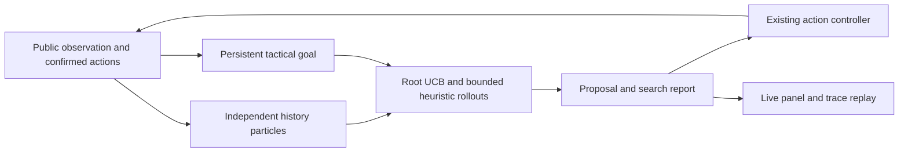

# Observable-history planning

Phase two adds `rollout` and `hierarchical` policies for the three starter
encounters. These are project-authored, non-learning baselines. The mechanics
engine remains the pinned upstream simulator with the lab's recorded fixes.
The full phase-two plan and remaining gates are in [PHASE2-PLAN.md](PHASE2-PLAN.md).

## Run and inspect

After the normal [installation](../README.md#quick-start), start a separate
dashboard to keep a phase-one service available:

```bash
.venv/bin/python -m uvicorn sts2lab.server:create_app --factory --host 127.0.0.1 --port 8766
```

Open `http://127.0.0.1:8766`, choose the Linux simulator, and select **平坦 Rollout**
or **分层 Rollout**. Create an experiment and step or run it. The decision panel
shows the actual model calls, completed rollouts, candidate visits, belief size,
initialization/conditioning work, fallback reason and active tactical goal.
Recorded replay uses stored reports and submits no actions. Pause during planning
stops subsequent actions; it does not undo an already confirmed action.

For a browser on another computer, forward this port over your existing SSH
connection or use `ssh -N -L 8766:127.0.0.1:8766 user@your-linux-host`. Keep the
service bound to loopback. No game or Mod reinstall is required for this simulator
workflow. The phase-one service can remain on 8765.

The API exposes the same controls:

```bash
curl --noproxy '*' -X POST http://127.0.0.1:8766/api/session \
  -H 'Content-Type: application/json' \
  -d '{"encounter":"nibbits-weak","seed":1,"policy":"hierarchical","policy_seed":773,"planning_config":{"search_calls":256,"rollout_depth":12,"max_wall_ms":2000}}'
```

This creates a paused simulator session and computes a proposal. Defaults are
8 particles, up to 512 independent opening attempts and 128 conditioning
attempts. A 2-second cooperative deadline covers belief work and search; one
native operation can finish after the deadline. Model-call limits are strict.
Belief initialization and conditioning are **additional**, separately reported
costs, not part of the `search_calls` allowance.

## Data flow and information boundary



The planner never receives the acting environment, its environment seed, exact
snapshot, private draw order or raw Mod response. Its own policy seed drives
independent simulator worlds. It rejects opening samples that disagree with
public state, then resamples, propagates the **actual confirmed action**, and
rejects inconsistent observations. Duplicate visible cards are interchangeable;
known top/bottom draw positions stay ordered. Manual overrides condition the
same history and terminate the previous goal.

This is an approximate finite-particle model. Resampling future RNG from a
surviving independent particle is not an exact posterior algorithm. Particles
can share ancestry; their count is not an effective sample size. Once depleted,
the policy uses a labeled heuristic fallback for the rest of that battle. It
never recovers by reading privileged execution state.

## Search and goals

Each distinct public root action gets sampled before UCB allocation begins.
Each branch follows the existing observable heuristic for at most the configured
depth. Equal visit ordinals share sampled scenarios across root actions where
possible. Equivalent duplicate actions share an estimate. Branches are not
executed actions or independent confidence-interval samples.

`starter-public-leaf-v1` scores terminal wins as `1 + 0.5 × HP fraction` and
losses as `−2`. Nonterminal utility combines remaining player HP, remaining
enemy HP and visible unblocked intent. Hierarchical planning adds fixed tactical
shaping for `survive_turn` or `focus_enemy`; `progress_combat` is the default.
The exact formula is in [hierarchy.py](../sts2lab/hierarchy.py).

A goal persists for at most three actions by default. Turn changes, target
removal, covered intent, manual overrides and terminal outcomes can end it
earlier. Each completed goal records its duration and accumulated real reward.
Reset, archive and shutdown also record interruption, including zero-action
goals. This is a fixed controller, not a learned options policy.

The real `terminal-win-v1` reward is unchanged: +1 win, −1 loss, 0 otherwise.
Candidate scores are sampled utility, **not win probabilities**. This is root
rollout search, not a full MCTS, ISMCTS or POMCP tree. An incomplete root-action
coverage budget or depleted belief produces an explicit heuristic fallback.

## Reproduce the comparison

[The frozen recipe](../config/phase2-planning.json) compares random, heuristic,
flat search and hierarchical search. Both search policies use 64 and 256 model
calls per decision, depth 8 and no wall-clock cutoff. The different interactive
default (depth 12, 2 seconds) must not be conflated with this evaluation.

```bash
# Optional small development smoke test: 18 episodes, first seed per encounter.
.venv/bin/python scripts/benchmark_planning.py --pilot --output artifacts/planning-pilot

# Complete development comparison: 180 episodes.
.venv/bin/python scripts/benchmark_planning.py --split development --output artifacts/planning-development

# Freeze and commit implementation/config first. Held-out mode requires a clean tree.
.venv/bin/python scripts/benchmark_planning.py --split heldout --output artifacts/planning-heldout
```

Output directories must be new. Reports preserve each episode, trace hashes,
configuration, source/native fingerprints, hardware, outcome, final HP, fallback
frequency, search and belief work, and decision-time samples. Timing includes
belief work and policy search, excluding the acting step, rendering and trace
I/O. This is sequential CPU evaluation on a shared host, not a throughput claim.
The runner retains partial results on error and stops; it never silently drops
a failed case.

Every recorded actor trajectory is independently re-executed. The first seed
of every encounter/search-policy/budget combination also gets a full policy
re-execution from **public observations and confirmed actions**, comparing
candidate values, visits, goals, fallback and selected actions. Elapsed time is
excluded. Exact policy replay refuses wall-clock budgets and changed planner or
model fingerprints. This checks reproducibility, not calibrated belief quality.

## Evidence boundaries

Historical phase-one reference replays test compatibility of recorded baseline
behavior with this branch. They do not certify the actions that new search
policies will choose. New original-game search captures, synchronized
decision-boundary game images, single-act map/reward/rest/shop support and
learned policies are still outstanding. See [PHASE2-STATUS.json](../PHASE2-STATUS.json).

Method references and implementation ownership are recorded in
[CODE-PROVENANCE.md](../CODE-PROVENANCE.md). There is no algorithmic novelty or
general performance-improvement claim.
